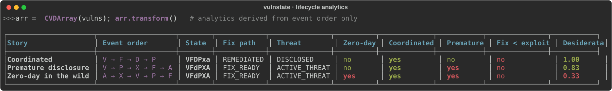
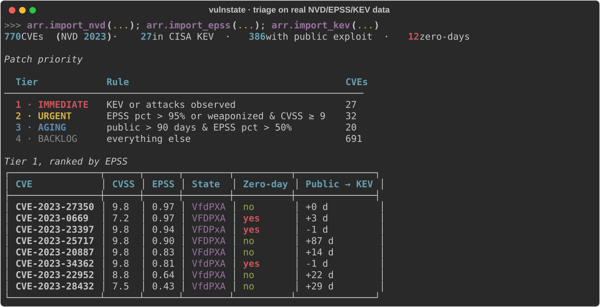
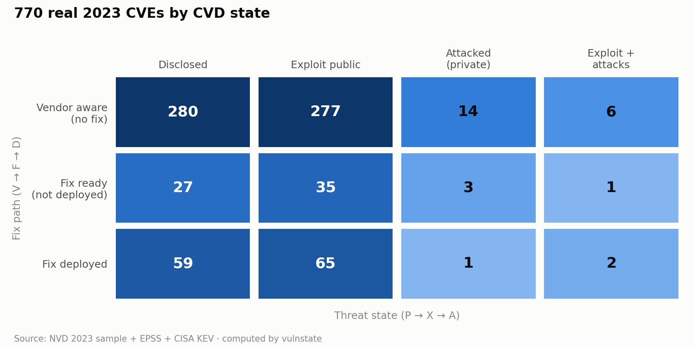

<h1 align="center">vulnstate</h1>

<p align="center">
  <b>Model every CVE as a disclosure state machine. Ask "was it a zero-day?", "did the fix beat the exploit?", "what do I patch first?" across your whole dataset in one line of NumPy.</b>
</p>

<p align="center">
  
  
  
  <a href="https://github.com/corifeo/vulnstate/actions/workflows/ci.yml"></a>
  
</p>

<p align="center">
  <a href="#installation">Install</a> ·
  <a href="#quick-start">Quick start</a> ·
  <a href="#triage-real-data-in-10-lines">Real-data triage</a> ·
  <a href="#the-model">The model</a> ·
  <a href="#analytics">Analytics</a> ·
  <a href="#data-import">Data import</a>
</p>

<p align="center">
  
</p>

A vulnerability's risk isn't just its CVSS score; it's **the order things happened in**. Did the vendor know before the exploit dropped? Was a patch out before attacks started? vulnstate tracks six lifecycle events per CVE and turns their ordering into zero-day flags, coordination quality, fix effectiveness and the 12 CVD desiderata. It's based on the SEI/CMU model by Householder & Spring ([CMU/SEI-2021-SR-021](https://www.sei.cmu.edu/library/a-state-based-model-for-multi-party-coordinated-vulnerability-disclosure-mpcvd/)).

- **One CVE or a million.** `CVDVulnerability` for a single timeline, `CVDArray` for vectorized NumPy analytics. Boolean filters over 1M records run in ~15 ms.
- **Real feeds built in.** NVD JSON (1.1 and 2.0), FIRST EPSS, CISA KEV, plus any CSV/JSON with dates, all merged by CVE ID.
- **No manual labelling.** Zero-day, premature disclosure, "fix before exploit" and the rest are all derived from timestamps.
- **Plays well with the stack.** pandas export, Jupyter HTML repr, Rich console output, type hints (`py.typed`).

## Installation

vulnstate isn't on PyPI yet. Install it from GitHub:

```bash
uv add git+https://github.com/corifeo/vulnstate
```

```bash
pip install git+https://github.com/corifeo/vulnstate
```

From source (includes the sample data, notebooks and tests):

```bash
git clone https://github.com/corifeo/vulnstate && cd vulnstate
uv sync --all-extras
```

Requires Python 3.9+. Extras: `viz` (matplotlib, seaborn, networkx), `notebook`, `dev`.

## Quick start

```python
from datetime import datetime
from vulnstate import CVDEvent, CVDVulnerability

vuln = CVDVulnerability("CVE-2024-0001", cvss_score=9.1)
vuln.apply_event(CVDEvent.V, timestamp=datetime(2024, 1, 1))   # vendor aware
vuln.apply_event(CVDEvent.F, timestamp=datetime(2024, 1, 8))   # fix ready
vuln.apply_event(CVDEvent.P, timestamp=datetime(2024, 2, 1))   # public

vuln.lifecycle.state   # 'VFdPxa'
vuln.fix_path          # FixPath.FIX_READY
vuln.threat_state      # ThreatState.DISCLOSED
vuln.is_zero_day       # False
vuln.is_coordinated    # True: vendor knew before the public did

print(vuln.format_timeline())
```

The V→F→D order is enforced: applying F before V returns `False` and leaves the state unchanged. P, X and A can arrive in any order, just like in real life.

## Triage real data in 10 lines

The repo ships a real sample: **770 CVEs from NVD 2023**, joined with EPSS scores and the CISA KEV catalog.

```python
from vulnstate import CVDArray, CVDEvent

arr = CVDArray()
arr.import_nvd("examples/sample_nvdcve_2023.json")   # V, F, P, X from NVD reference tags
arr.import_epss("examples/sample_epss.csv")          # exploitation probability
arr.import_kev("examples/sample_kev.csv")            # known exploited -> event A
arr.transform()                                      # compute analytics (run after imports)

immediate = arr.kev | arr.is_under_attack
urgent = ~immediate & ((arr.epss_percentile > 0.95) |
                       (arr.is_weaponized & (arr.cvss_scores >= 9.0)))

arr.cve_ids[immediate & arr.is_zero_day]   # exploited before the vendor knew
```

<p align="center">
  
</p>

Every number above comes from the sample data; `scripts/make_readme_assets.py` regenerates it. Note **Public → KEV**: several 2023 CVEs were in KEV within days of disclosure, and some were listed *before* NVD published them.

Each CVE sits on two axes, remediation progress (V→F→D) and threat (P→X→A). In this sample, more than 70% have a known vendor and no fix:

<picture>
  <source media="(prefers-color-scheme: dark)" srcset=".github/assets/fix_threat_dark.png">
  
</picture>

## The model

Each vulnerability tracks six events. A state like `VFdPxa` means vendor aware, fix ready, **not** deployed, public, no exploit, no attacks (uppercase = happened).

| Event | Meaning | Rule |
|---|---|---|
| **V** | Vendor aware | before F |
| **F** | Fix ready | before D |
| **D** | Fix deployed | needs F |
| **P** | Public aware | any order |
| **X** | Exploit public | any order |
| **A** | Attacks observed | any order |

That gives 32 valid states out of 64 bit combinations, stored as a `uint8` bitmask. Analytics come from the **timestamps**: the 12 desiderata are the "good" orderings (V before P, F before X, D before A, …), and each CVE is scored on how many it satisfies.

## Analytics

On `CVDArray` every property is a NumPy array (after `arr.transform()`), so masks combine with `&`, `|` and `~`. The zero-day, coordination and fix-effectiveness flags are also available as scalars on `CVDVulnerability`.

| Group | Properties |
|---|---|
| Zero-day | `is_zero_day`, `is_zero_day_exploit` (X before V), `is_zero_day_attack` (A before V) |
| Coordination | `is_coordinated` (V before P), `is_responsible_disclosure` (V→F→P), `is_premature_disclosure` (P before F) |
| Fix effectiveness | `has_fix_before_exploit`, `has_fix_before_attack`, `has_deployment_before_exploit`, `has_deployment_before_attack` |
| Threat | `is_weaponized`, `is_under_attack`, `is_private_attack` (A without X), `is_mass_exploitation` |
| Timing (days) | `disclosure_window_days` (V→P), `fix_lag_days` (V→F), `deployment_lag_days` (F→D) |
| Scores | `desiderata_score`, `skill_score`, `desiderata_mask`, `fix_path`, `threat_state` |
| Enrichment | `cvss_scores`, `attack_vector`, `epss`, `epss_percentile`, `kev`, `kev_dates` |

```python
from vulnstate.constants import AntiDesiderataBit, DesiderataBit

arr[arr.is_zero_day_exploit | (arr.kev & ~arr.has_fix_before_exploit)]
arr[arr.where_desiderata_satisfied(DesiderataBit.D1_V_P)]      # vendor knew first
arr[arr.where_desiderata_violated(AntiDesiderataBit.U2_X_V)]   # exploit before vendor
arr[arr.event_age_days(CVDEvent.P) > 90]                       # public for 90+ days

arr.count_by_state()          # {'VfdPxa': 280, 'VfdPXa': 277, ...}
arr.count_by_fix_path()
df = arr.to_dataframe()       # one row per CVE, analytics included
```

## Data import

Sources are merged by CVE ID; each one applies its events with real timestamps. Paths can be local files or URLs.

```python
arr.import_nvd("nvdcve-2.0-2024.json")      # NVD JSON 1.1 or 2.0
arr.import_nvd_glob("nvdcve-*.json")
arr.import_epss("epss_scores.csv")
arr.import_kev("known_exploited_vulnerabilities.csv")

# Any CSV/JSON with a CVE column and a date becomes a lifecycle event
arr.import_csv("patch_rollout.csv", cve_column="cve_id",
               event=CVDEvent.D, timestamp_column="deployed_date")
arr.import_json("intel.json", cve_field="vuln.cve_id",   # dot notation for nesting
                event=CVDEvent.A, timestamp_field="intel.first_seen")

arr.transform()
arr.to_json_batch("snapshot.json", include_computed=True)
```

Synthetic data for experiments: `CVDArray.generate(10_000, seed=42)` (realistic timelines and CVSS) or `CVDArray.random(n)`.

For a complete, runnable walkthrough, see [`scripts/make_readme_assets.py`](scripts/make_readme_assets.py). It builds every image in this README from the sample data.

## Development

```bash
uv sync --all-extras
uv run pytest                                                   # test suite
uv run mypy src/ --strict
uv run ruff check src/ tests/
uv run --extra viz python scripts/make_readme_assets.py         # regenerate README images
```

Issues and PRs are welcome, especially new data importers (OSV, GitHub Security Advisories, vendor advisories) and analytics from the CVD literature.

## Citation

vulnstate implements the model below. To cite vulnstate itself, use **Cite this repository** on GitHub ([`CITATION.cff`](CITATION.cff)).

> Householder, A. D., & Spring, J. (2021). *A State-Based Model for Multi-Party Coordinated Vulnerability Disclosure (MPCVD)*. CMU/SEI-2021-SR-021. Software Engineering Institute, Carnegie Mellon University.

## License

MIT
